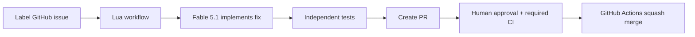

# Lua issue-to-PR coworker

Assign an open GitHub issue with the `lua-ready` label. Lua clones the configured repository into a run branch, uses **Fable 5.1** to implement the fix, independently runs the configured checks, pushes the verified commit, and opens a PR. A human reviews it in GitHub. GitHub Actions squash-merges it after the current commit has enough human approvals and passing required CI.

The local implementation is ready to configure. It has not been published or enabled against a repository. `OWNER/REPOSITORY` is deliberately a placeholder. The existing `lua.skill.yaml` agent and organization binding have been preserved.



## Model and hosting

`src/model.ts` pins `anthropic/claude-fable-5-1`. Both the chat coworker and the workflow's coding step use that exact code. Changing `codingModel` to another value fails configuration validation. There are no model classes, model-selection resolvers, or alternative models in this project.

Lua hosts the agent, workflow workers, and coding containers. GitHub Actions dispatches issues and performs the merge. This code does not call an external model API or require an OpenAI/Anthropic API key. Lua must make Fable 5.1 available to your organization.

Before activation, verify the live model catalog and workflow policy:

```bash
npm run lua -- models list --workflows
npm run lua -- workflows policy models get
```

Lua can apply organization-level model fallback policy. For a strict Fable-only deployment, the workflow policy must allow only `anthropic/claude-fable-5-1`; a provider outage should stop work rather than select another model. In a dedicated organization, an administrator can configure that with:

```bash
npm run lua -- workflows policy models set --allow anthropic/claude-fable-5-1
```

This setting affects every workflow in that organization. It has not been changed here. If this is a shared organization, settle its policy before enabling this agent. See [Lua models](https://docs.heylua.ai/concepts/models) and [workflow model policy](https://docs.heylua.ai/reference/cli/workflows#policy-models).

## Local development

Use Node 22 or later. The workspace currently uses the preinstalled Lua CLI 3.47.0 SDK through a local symlink. Fresh installation requires npm registry access:

```bash
cd issue-to-PR-agent
npm install
npm test
npm run compile
npm run test:workflow
```

The scaffold's old lockfile pinned an incompatible SDK. It was saved under `../.tools/issue-to-pr-original-package-lock.json`. Registry access was unavailable, so no replacement lockfile is shipped yet. Run `npm install` and commit the generated lockfile when setting up a fresh checkout.

`npm test` covers issue eligibility, duplicate PRs, independent verification, real Git changes including protected-file renames, SHA checks, human-review requirements, required CI, and Fable-only model requests. `npm run test:workflow` exercises the compiled Lua graph against a scratch repository: a real passing test command reaches a mocked PR output; a real failing test command stops at verification. Model calls, issue reads, pushes, and PR creation are mocked in that smoke test. It performs no remote writes or paid model calls. The scratch fixture uses the default npm commands; adapt it before running this smoke test with custom target commands.

## Configure your repository

Edit `engineer.config.json` before deploying:

| Setting | What to choose |
| --- | --- |
| `repository` | Exact `owner/repo` |
| `baseBranch` | Repository default branch, initially `main` |
| `issueLabel` | Label maintainers apply to assign work |
| `installCommands` | Argument arrays for installing the target repo's dependencies |
| `checks` | Real lint/test/build commands for the target repo |
| `requiredStatusChecks` | Exact GitHub CI check context names, not workflow filenames |
| `minimumApprovals` | At least one human with write, maintain, or admin permission |
| `maxChangedFiles` | Maximum size of an issue fix, initially 30 files |
| `protectedPaths` | Files the coworker may not modify |
| `budget` | Lua credit, step, and run duration limits |

The initial target commands are `npm ci`, `npm run lint`, and `npm test`. Replace them if your target repository uses different commands. `npm ci` applies to the **target repository**, which must already have its own valid lockfile. Required CI must run on the PR's head commit.

The default protected paths include `.github/`, `.lua/`, `.agents/`, `.codex/`, and every `AGENTS.md`. Issues that require changes to these files stop for manual handling. Empty changes, dirty checkouts, failed tests, changed commits during verification, and changed remote SHAs block publication.

## Connect Lua and publish

The project is already bound to the agent in `lua.skill.yaml`. Authenticate and connect GitHub to that agent:

```bash
npm run lua -- auth configure
npm run lua -- integrations connect --integration github
npm run check:setup
npm test
npm run compile
npm run lua -- push all --ci
```

Lua CLI 3.47.0 publishes and activates workflows with `push all`. Keep GitHub dispatch disabled while configuring it. Verify the active workflow and model in Lua before enabling the GitHub trigger. Use [Lua's publishing documentation](https://docs.heylua.ai/build/workflows/quickstart) for version management.

Connect a GitHub bot/service account with repository write access, or arrange a separate human reviewer. GitHub does not let an account approve a PR it authored. If your Lua GitHub connection is your own account, another human must review the resulting PRs.

## Install the GitHub automation

Generate a local preview now, or generate configured files after choosing the repository:

```bash
npm run prepare:github -- --preview
# After configuring repository and checks:
npm run prepare:github
```

Both commands write files under `target-repo/.github/`. To stage them directly in a separate target checkout, pass its directory to `prepare:github`. Existing files with the same names are replaced; use the default staging directory first if reviewing an installation.

Copy the two workflow YAML files and the `.github/lua-engineer/` control files into a setup PR on the target repository. Review and merge that setup PR into its default branch.

Configure the base branch with enforced protection or an active branch ruleset:

- Require at least `minimumApprovals` approving reviews and dismiss stale approvals after pushes.
- Require the exact `requiredStatusChecks` contexts.
- Enforce the classic rule for administrators, or use active rulesets without bypass actors.
- Enable squash merging in repository settings.

A disabled ruleset template is generated as `.github/lua-engineer/branch-ruleset.json`. Review it and activate the equivalent rules through GitHub settings; copying that JSON into the repo does not create a ruleset. Preserve any stronger existing protections.

Add these Actions settings in the target repository:

| Kind | Name | Value |
| --- | --- | --- |
| Secret | `LUA_API_KEY` | Lua API key authorized to start this agent's workflows |
| Variable | `LUA_AGENT_ID` | `agent.agentId` from `lua.skill.yaml` |
| Variable | `LUA_ENGINEER_ENABLED` | Keep `false` during setup; set `true` after validation |

The merge uses GitHub's workflow token. No GitHub credential is stored in Lua source or in these scripts. Privileged automation reads its executable scripts and configuration from a single commit on the trusted default branch and never checks out or executes PR code. The GitHub Action is pinned to a verified commit.

The merge scan runs on PR updates and on a five-minute schedule. Human approval and CI completion may therefore be followed by a scheduling delay. A reviewer can also run the merge workflow manually. GitHub remains the final enforcement point, and the merge request includes the exact reviewed SHA.

## Use and operate

Apply the assignment label to an open issue, or run **Lua engineer - assign issue** in GitHub Actions with its issue number. Maintainers with triage or higher permission may dispatch work. The Actions summary provides the Lua run ID.

You can also ask the coworker to resolve an issue in its configured repository. The tool uses the same workflow and an idempotency key based on repository, issue number, and attempt.

For a failed or cancelled run, inspect it before increasing the `attempt` input. Reusing an attempt returns the same run. Do not start a new attempt while an earlier run is active; an existing engineering PR also prevents a second implementation run.

```bash
npm run lua -- workflows status RUN_ID --steps
npm run lua -- workflows job-logs RUN_ID implement --tail 500
npm run lua -- workflows jobs RUN_ID
```

Failed push/PR side effects park for inspection instead of being blindly repeated. Requested changes, missing reviews, stale approvals, CI failures, and protected-file changes prevent automatic merging. This first version creates the initial fix and PR; autonomous responses to review comments are a future extension. Humans can revise the PR and submit fresh approval after the new commit passes CI.

To stop new assignments and automated merges, set `LUA_ENGINEER_ENABLED=false`. Runs already underway remain visible in Lua and can be cancelled there.
